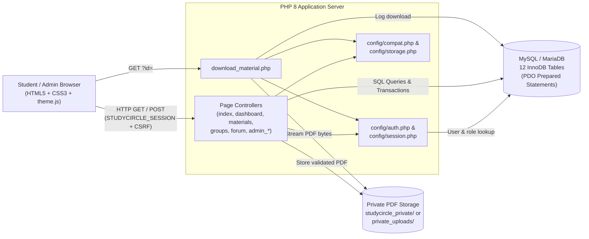
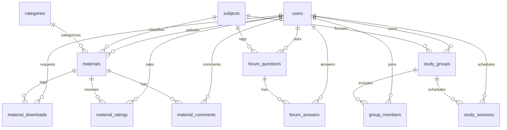

# StudyCircle — Collaborative Learning Platform

A server-rendered collaborative learning web application built for **NSBM Green University** (Faculty of Computing, Batch 26.1 IFSL) under Project Topic 4: *Student Community for Notes and Study Sharing*. StudyCircle enables students to share and review PDF study materials, ask and answer academic questions, form subject-focused study groups, and schedule group study sessions with administrative moderation and reporting.


---

## Table of Contents

- [1. Project Overview](#1-project-overview)
- [2. Live Demo](#2-live-demo)
- [3. Screenshots](#3-screenshots)
- [4. Key Features](#4-key-features)
- [5. Technology Stack](#5-technology-stack)
- [6. System Architecture](#6-system-architecture)
- [7. Project Folder Structure](#7-project-folder-structure)
- [8. Local Installation and Setup](#8-local-installation-and-setup)
- [9. Environment Configuration](#9-environment-configuration)
- [10. Database Structure](#10-database-structure)
- [11. API & Route Documentation](#11-api--route-documentation)
- [12. Authentication and Security](#12-authentication-and-security)
- [13. Testing](#13-testing)
- [14. Troubleshooting](#14-troubleshooting)
- [15. Future Improvements](#15-future-improvements)
- [16. Project Contributors](#16-project-contributors)
- [17. Project Deliverables](#17-project-deliverables)
- [18. License](#18-license)
- [19. Support](#19-support)

---

## 1. Project Overview

University students frequently rely on scattered messaging threads and unorganized file shares to exchange lecture notes, past-paper solutions, and revision schedules. **StudyCircle** centralizes these academic workflows into a structured, role-moderated platform:

- **Curated Resource Sharing:** Students upload PDF study materials up to 1 MiB, which remain queued in `pending` status until reviewed and approved by an administrator.
- **Peer Q&A & Resource Feedback:** Students rate approved resources (1–5 stars), post material comments, and participate in a subject-tagged academic discussion forum.
- **Collaborative Study Groups & Scheduling:** Students create or join subject-aligned study groups and schedule upcoming study sessions in Sri Lanka Standard Time (`Asia/Colombo`).
- **Administrative Governance & Analytics:** Administrators manage subjects and resource categories, review PDF submissions, moderate forum and comment threads, control student account access (`active` / `blocked`), and export printable usage reports.

> **Architecture Note:** Unlike decoupled SPA + REST API stacks (e.g., React + Node.js/MongoDB), StudyCircle is implemented purely as a **server-rendered PHP 8 + PDO + MySQL/MariaDB** web application with progressive JavaScript enhancements (`theme.js` and form confirmation/visibility toggles).

---

## 2. Live Demo

| Resource | Location |
|---|---|
| **Hosted Application** | [https://studycircle.free.je/](https://studycircle.free.je/) *(hosted deployment reference from repository documentation)* |
| **Source Repository** | [https://github.com/udaraXv/StudyCircle](https://github.com/udaraXv/StudyCircle) |

---

## 3. Screenshots

All screenshots below were captured directly from the running StudyCircle application using realistic demonstration data at a `1440×900` desktop viewport.

### Landing Page


### Authentication
| Login Page | Student Registration Page |
|---|---|
|  |  |

### Student Dashboard & Profile
| Student Dashboard | User Profile |
|---|---|
|  |  |

### Study Groups & Study Sessions
| Study Groups Directory & Creation | Group Study Sessions Scheduler |
|---|---|
|  |  |

### Academic Q&A Forum (Group & Community Communication)
| Discussion Forum | Question & Answers Thread |
|---|---|
|  |  |

### Learning Resources
| Approved Materials Browser | Material Details, Ratings & Comments |
|---|---|
|  |  |

| Upload PDF Material | Personal Uploads & Approval Status |
|---|---|
|  |  |

### Administration & Usage Reports
| Admin Dashboard | Material Review Queue |
|---|---|
|  |  |

| Usage & Engagement Report | Student Account Management |
|---|---|
|  |  |

> **Screenshot Availability Note:** StudyCircle does not implement a real-time group chat interface, standalone group-detail page (group members access `group_sessions.php?group_id=<id>` directly), or separate session-detail page (sessions render as cards within `group_sessions.php`). Accordingly, `group-chat.png`, `group-details.png`, and `session-details.png` are omitted rather than fabricated.

---

## 4. Key Features

### 4.1 User Authentication and Profiles
- **Student Registration (`register.php`):** Collects full name (up to 100 chars), unique student ID (up to 50 chars), unique email address (up to 254 chars), and password (8–72 bytes, bcrypt-hashed).
- **Session Login & Logout (`login.php`, `logout.php`):** Authenticates active users via `password_verify()`, regenerates the PHP session ID on login, and enforces CSRF-protected `POST` logout.
- **User Profile (`profile.php`):** Displays initial-based avatar badge, full name, email address, student ID, account role (`Student` / `Administrator`), account status (`Active` / `Blocked`), and join date.
  - *Scope note:* Custom profile picture uploads, university faculty/batch fields on the user record, and self-service profile editing are **not implemented**.

### 4.2 Study Group Management
- **Public Subject Groups (`groups.php`):** Students can create study groups linked to an admin-defined subject, edit or delete groups they own, and join or leave other groups.
- **Ownership & Membership:** Group creators (`owner_id`) are automatically inserted into `group_members` within a database transaction and cannot leave their own group without deleting it.
  - *Scope note:* Private/invite-only groups, join-request queues, and granular moderator roles are **not implemented**; all groups are open to any active student.

### 4.3 Study Session Management
- **Session Scheduling (`group_sessions.php`):** Group members can schedule study sessions with a title, physical location or online meeting link, and start/end `datetime-local` values validated in `Asia/Colombo` (start time must be in the future; end time must be after start time).
- **Filtering & Permissions:** Sessions can be filtered by `all`, `upcoming`, `ongoing`, or `past`. Only the session creator or the parent group owner can edit or delete a session.
  - *Scope note:* Session attendance/RSVP tracking and dedicated post-session feedback forms are **not implemented**.

### 4.4 Group Communication
- **Academic Q&A Forum (`forum.php`, `question.php`):** Students post subject-tagged academic questions and answers, search by keyword, filter by subject, and edit or delete their own posts. Administrators can delete questions or answers for moderation.
- **Material Comments (`material_details.php`):** Students can comment on approved study materials and delete their own comments (admins can moderate any comment).
  - *Scope note:* Real-time WebSocket or polling group chat is **not implemented**.

### 4.5 Learning Resource Sharing
- **Secure PDF Upload (`upload_material.php`):** Students upload PDF files up to **1 MiB (1,048,576 bytes)** categorized by subject and resource type. Files are stored outside the public web root (or in a `.htaccess`-protected directory on shared hosting) with randomized 48-hex-character filenames.
- **Submission Lifecycle (`my_uploads.php`):** Students filter personal submissions by `pending`, `approved`, or `rejected`. Editing metadata resets a material back to `pending` for re-review; deleting removes both the database record and stored PDF file.
- **Discovery, Ratings & Downloads (`materials.php`, `material_details.php`, `download_material.php`):** Students search approved materials by title, description, subject code, or subject name; filter by subject and category; sort by newest, oldest, or title; submit/update/remove 1–5 star ratings; and stream approved PDFs with student download request tracking.

### 4.6 Additional Features
- **Light & Dark Theme (`theme.js`, `theme.css`):** Respects `prefers-color-scheme`, persists user choice in `localStorage` (`studycircle-theme`), and synchronizes across browser tabs via `storage` events.
- **Admin Governance (`admin_*.php`):** Dedicated admin dashboard, submission approval/rejection queue (`admin_materials.php`), subject CRUD (`admin_subjects.php`), category CRUD (`admin_categories.php`), student search and account blocking/reactivation (`admin_users.php`), and printable usage/engagement reports (`admin_reports.php`).
- **Informational Pages:** Project overview (`about.php`), study tips (`study_tips.php`), and expandable FAQ (`faq.php`).

---

## 5. Technology Stack

### Frontend
| Technology | Purpose |
|---|---|
| **HTML5** | Semantic multi-page templates rendered by PHP |
| **CSS3** | Responsive layouts, CSS custom properties (`site.css`, `theme.css`, `branding.css`, `nsbm-professional.css`), and print stylesheets (`@media print` in `admin_reports.php`) |
| **JavaScript (ES5/Vanilla)** | Light/dark theme persistence (`theme.js`), password visibility toggles, and client-side delete confirmations |
| **SVG Assets** | Custom campus and branding graphics (`assets/*.svg`) |

### Backend
| Technology | Version / Details | Purpose |
|---|---|---|
| **PHP** | 8.2+ *(verified on PHP 8.2.12; repository authored for PHP 8.3)* | Server-side request handling, business logic, and HTML rendering |
| **PDO (`pdo_mysql`)** | Built-in PHP extension | Parameterized SQL queries, transactions, and error handling |
| **Fileinfo & mbstring** | Built-in PHP extensions (with fallbacks in `config/compat.php`) | PDF MIME verification and UTF-8 string handling |

### Database
| Technology | Version / Details | Purpose |
|---|---|---|
| **MySQL / MariaDB** | MySQL 8.4 or MariaDB 10.4+ *(verified on MariaDB 10.4.32)* | Relational storage across 12 InnoDB tables (`utf8mb4_unicode_ci`) |

### Development & Hosting Tools
| Tool | Purpose |
|---|---|
| **WampServer / XAMPP / PHP CLI** | Local Apache/PHP/MySQL runtime environment |
| **InfinityFree Compatibility (`config/compat.php`, `config/storage.example.php`)** | Environment detection (`app_is_local()`), error display suppression in production, and `.htaccess`-protected upload folder fallback |
| **Git & GitHub** | Version control across feature branches (`mihiran-auth`, `maneesha-materials`, `hirundi-uploads`, `kalana-groups`, `yashiru-forum`, `rashmi-admin`, `venushi-reports`, `udara-dashboard`) |

---

## 6. System Architecture

StudyCircle follows a **classic server-rendered multi-page PHP architecture** with centralized configuration helpers and a single relational MySQL database.

1. **Request Lifecycle:** Every user interaction hits a `.php` entry point directly (e.g., `materials.php`, `groups.php`). Protected pages call `require_login()` or `require_admin()` from `config/auth.php`, which starts the hardened session (`config/session.php`), connects via PDO (`config/db.php`), and verifies the user exists with `status = 'active'`.
2. **State Mutations & PRG Pattern:** Form submissions use `POST` with CSRF token verification (`valid_csrf()`), execute parameterized PDO statements (using `BEGIN`/`COMMIT` + `FOR UPDATE` locks for group and session concurrency), store flash feedback in `$_SESSION`, and redirect with `header('Location: ...')` (Post/Redirect/Get).
3. **Private File Streaming:** Uploaded PDFs are never placed in a directly browsable public path. `download_material.php` checks authentication, enforces `status = 'approved'` for students, logs student downloads into `material_downloads`, and streams bytes via `fpassthru()` with `X-Content-Type-Options: nosniff`.



---

## 7. Project Folder Structure

Tracked files in the repository (plus documentation assets):

```text
StudyCircle/
├── .gitignore                   # Excludes local db.php, storage.php, uploads, logs, and SQL dumps
├── README.md                    # Project documentation
├── assets/                      # Static SVG graphics and university branding
│   ├── campus-study.svg
│   ├── nsbm-campus.svg
│   ├── nsbm-logo.svg
│   └── study-space.svg
├── config/                      # Shared runtime configuration and security helpers
│   ├── auth.php                 # escape(), CSRF helpers, require_login(), require_admin()
│   ├── compat.php               # Local/prod detection, Asia/Colombo TZ, mbstring & MIME fallbacks
│   ├── session.php              # Hardened session cookie setup (STUDYCIRCLE_SESSION)
│   ├── storage.example.php      # Reference template for private PDF directory & .htaccess guard
│   ├── db.php                   # (Gitignored — created locally) PDO MySQL connection
│   └── storage.php              # (Gitignored — created locally) Active PDF storage path
├── docs/
│   └── screenshots/             # Verified application screenshots used in README
│       ├── admin/
│       ├── authentication/
│       ├── forum/
│       ├── groups/
│       ├── resources/
│       └── sessions/
├── index.php                    # Public landing page
├── about.php                    # Project overview page
├── study_tips.php               # Student study habits guide
├── faq.php                      # Help & FAQ accordion page
├── register.php                 # Student account registration
├── login.php                    # Student & admin sign-in
├── logout.php                   # CSRF-protected POST sign-out
├── dashboard.php                # Student dashboard with upload/group stats
├── profile.php                  # Read-only user profile view
├── materials.php                # Searchable & filterable approved resource browser
├── material_details.php         # Resource details, 1–5 star ratings, and comments
├── upload_material.php          # Student PDF upload form (<= 1 MiB)
├── my_uploads.php               # Personal submission status tracker, metadata editor & delete
├── download_material.php        # Authenticated PDF stream & student download logger
├── forum.php                    # Academic Q&A listing, search, and question composer
├── question.php                 # Question thread and answer CRUD
├── groups.php                   # Study group directory, creation, join/leave, edit/delete
├── group_sessions.php           # Group study session scheduler and status filter
├── admin_dashboard.php          # Administrator overview & tool directory
├── admin_materials.php          # Pending/approved/rejected material review queue
├── admin_subjects.php           # Subject catalog CRUD (prevents deleting in-use subjects)
├── admin_categories.php         # Resource category CRUD (prevents deleting in-use categories)
├── admin_users.php              # Student search and active/blocked access control
├── admin_reports.php            # Usage analytics, top 10 resources, subject breakdown & print view
├── site.css                     # Core layout, header, grid, card, and button styles
├── theme.css                    # Light/dark theme CSS custom properties and component overrides
├── theme.js                     # Client-side theme switcher with localStorage & tab sync
├── branding.css                 # NSBM brand accent gradients and header logo styling
└── nsbm-professional.css        # Typography, surface elevation, and spacing refinements
```

---

## 8. Local Installation and Setup

### 8.1 Prerequisites
- **PHP 8.2 or 8.3** with extensions: `pdo_mysql`, `mbstring` *(recommended)*, `fileinfo` *(recommended)*.
- **MySQL 8.0 / 8.4** or **MariaDB 10.4+**.
- **Apache** (via WampServer or XAMPP) or **PHP's built-in development server** (`php -S`).
- **Git** (to clone the repository).

> **Note:** This project has no `package.json`, Node.js runtime, or frontend build pipeline.

### 8.2 Clone the Repository
```bash
git clone https://github.com/udaraXv/StudyCircle.git
cd StudyCircle
```

### 8.3 Frontend Setup
No build step or package installation is required. All CSS (`site.css`, `theme.css`, `branding.css`, `nsbm-professional.css`), JavaScript (`theme.js`), and SVG assets (`assets/`) are served directly alongside the PHP templates.

### 8.4 Backend Setup
Two gitignored PHP configuration files are required at runtime:
1. `config/db.php` — defines the `$pdo` connection instance.
2. `config/storage.php` — defines `$storageDirectory` for uploaded PDFs (a starter template exists at `config/storage.example.php`).

On Windows with WampServer or XAMPP, copy `config/storage.example.php` to `config/storage.php` (or point `$storageDirectory` to a writable directory outside the web root), and create `config/db.php` as shown in [Section 9](#9-environment-configuration).

### 8.5 Environment Configuration
Create a writable private storage folder (for example, `C:\wamp64\studycircle_private` or a sibling `studycircle_private` folder) and configure `config/storage.php` and `config/db.php` using the examples in [Section 9](#9-environment-configuration).

### 8.6 Database Configuration
> **Important:** While the original repository documentation referenced `database/schema.sql`, no `.sql` file is currently tracked in the `main` branch (and `/nsbm_studycircle.sql` is gitignored). Use the schema below—verified directly against every SQL query in the PHP codebase—to initialize the `nsbm_studycircle` database.

1. Create the database:
```sql
CREATE DATABASE nsbm_studycircle
  CHARACTER SET utf8mb4
  COLLATE utf8mb4_unicode_ci;
USE nsbm_studycircle;
```

2. Create the 12 required tables:
```sql
CREATE TABLE users (
    id INT AUTO_INCREMENT PRIMARY KEY,
    full_name VARCHAR(100) NOT NULL,
    email VARCHAR(254) NOT NULL UNIQUE,
    student_id VARCHAR(50) NOT NULL UNIQUE,
    password_hash VARCHAR(255) NOT NULL,
    role ENUM('student', 'admin') NOT NULL DEFAULT 'student',
    status ENUM('active', 'blocked') NOT NULL DEFAULT 'active',
    created_at TIMESTAMP NOT NULL DEFAULT CURRENT_TIMESTAMP
) ENGINE=InnoDB DEFAULT CHARSET=utf8mb4 COLLATE=utf8mb4_unicode_ci;

CREATE TABLE subjects (
    id INT AUTO_INCREMENT PRIMARY KEY,
    subject_code VARCHAR(30) NOT NULL UNIQUE,
    subject_name VARCHAR(150) NOT NULL,
    created_at TIMESTAMP NOT NULL DEFAULT CURRENT_TIMESTAMP
) ENGINE=InnoDB DEFAULT CHARSET=utf8mb4 COLLATE=utf8mb4_unicode_ci;

CREATE TABLE categories (
    id INT AUTO_INCREMENT PRIMARY KEY,
    name VARCHAR(100) NOT NULL UNIQUE,
    created_at TIMESTAMP NOT NULL DEFAULT CURRENT_TIMESTAMP
) ENGINE=InnoDB DEFAULT CHARSET=utf8mb4 COLLATE=utf8mb4_unicode_ci;

CREATE TABLE materials (
    id INT AUTO_INCREMENT PRIMARY KEY,
    uploaded_by INT NOT NULL,
    subject_id INT NOT NULL,
    category_id INT NOT NULL,
    title VARCHAR(150) NOT NULL,
    description TEXT NOT NULL,
    original_name VARCHAR(255) NOT NULL,
    stored_name VARCHAR(64) NOT NULL,
    file_size INT UNSIGNED NOT NULL,
    status ENUM('pending', 'approved', 'rejected') NOT NULL DEFAULT 'pending',
    created_at TIMESTAMP NOT NULL DEFAULT CURRENT_TIMESTAMP,
    CONSTRAINT fk_materials_user FOREIGN KEY (uploaded_by) REFERENCES users(id) ON DELETE CASCADE,
    CONSTRAINT fk_materials_subject FOREIGN KEY (subject_id) REFERENCES subjects(id) ON DELETE RESTRICT,
    CONSTRAINT fk_materials_category FOREIGN KEY (category_id) REFERENCES categories(id) ON DELETE RESTRICT
) ENGINE=InnoDB DEFAULT CHARSET=utf8mb4 COLLATE=utf8mb4_unicode_ci;

CREATE TABLE material_downloads (
    id INT AUTO_INCREMENT PRIMARY KEY,
    material_id INT NOT NULL,
    user_id INT NOT NULL,
    created_at TIMESTAMP NOT NULL DEFAULT CURRENT_TIMESTAMP,
    CONSTRAINT fk_downloads_material FOREIGN KEY (material_id) REFERENCES materials(id) ON DELETE CASCADE,
    CONSTRAINT fk_downloads_user FOREIGN KEY (user_id) REFERENCES users(id) ON DELETE CASCADE
) ENGINE=InnoDB DEFAULT CHARSET=utf8mb4 COLLATE=utf8mb4_unicode_ci;

CREATE TABLE material_ratings (
    id INT AUTO_INCREMENT PRIMARY KEY,
    material_id INT NOT NULL,
    user_id INT NOT NULL,
    rating TINYINT UNSIGNED NOT NULL,
    created_at TIMESTAMP NOT NULL DEFAULT CURRENT_TIMESTAMP,
    updated_at TIMESTAMP NOT NULL DEFAULT CURRENT_TIMESTAMP ON UPDATE CURRENT_TIMESTAMP,
    UNIQUE KEY uq_material_user_rating (material_id, user_id),
    CONSTRAINT fk_ratings_material FOREIGN KEY (material_id) REFERENCES materials(id) ON DELETE CASCADE,
    CONSTRAINT fk_ratings_user FOREIGN KEY (user_id) REFERENCES users(id) ON DELETE CASCADE
) ENGINE=InnoDB DEFAULT CHARSET=utf8mb4 COLLATE=utf8mb4_unicode_ci;

CREATE TABLE material_comments (
    id INT AUTO_INCREMENT PRIMARY KEY,
    material_id INT NOT NULL,
    user_id INT NOT NULL,
    body TEXT NOT NULL,
    created_at TIMESTAMP NOT NULL DEFAULT CURRENT_TIMESTAMP,
    CONSTRAINT fk_comments_material FOREIGN KEY (material_id) REFERENCES materials(id) ON DELETE CASCADE,
    CONSTRAINT fk_comments_user FOREIGN KEY (user_id) REFERENCES users(id) ON DELETE CASCADE
) ENGINE=InnoDB DEFAULT CHARSET=utf8mb4 COLLATE=utf8mb4_unicode_ci;

CREATE TABLE forum_questions (
    id INT AUTO_INCREMENT PRIMARY KEY,
    user_id INT NOT NULL,
    subject_id INT NOT NULL,
    title VARCHAR(150) NOT NULL,
    body TEXT NOT NULL,
    created_at TIMESTAMP NOT NULL DEFAULT CURRENT_TIMESTAMP,
    CONSTRAINT fk_questions_user FOREIGN KEY (user_id) REFERENCES users(id) ON DELETE CASCADE,
    CONSTRAINT fk_questions_subject FOREIGN KEY (subject_id) REFERENCES subjects(id) ON DELETE RESTRICT
) ENGINE=InnoDB DEFAULT CHARSET=utf8mb4 COLLATE=utf8mb4_unicode_ci;

CREATE TABLE forum_answers (
    id INT AUTO_INCREMENT PRIMARY KEY,
    question_id INT NOT NULL,
    user_id INT NOT NULL,
    body TEXT NOT NULL,
    created_at TIMESTAMP NOT NULL DEFAULT CURRENT_TIMESTAMP,
    updated_at TIMESTAMP NOT NULL DEFAULT CURRENT_TIMESTAMP ON UPDATE CURRENT_TIMESTAMP,
    CONSTRAINT fk_answers_question FOREIGN KEY (question_id) REFERENCES forum_questions(id) ON DELETE CASCADE,
    CONSTRAINT fk_answers_user FOREIGN KEY (user_id) REFERENCES users(id) ON DELETE CASCADE
) ENGINE=InnoDB DEFAULT CHARSET=utf8mb4 COLLATE=utf8mb4_unicode_ci;

CREATE TABLE study_groups (
    id INT AUTO_INCREMENT PRIMARY KEY,
    owner_id INT NOT NULL,
    subject_id INT NOT NULL,
    name VARCHAR(100) NOT NULL,
    description TEXT NOT NULL,
    created_at TIMESTAMP NOT NULL DEFAULT CURRENT_TIMESTAMP,
    CONSTRAINT fk_groups_owner FOREIGN KEY (owner_id) REFERENCES users(id) ON DELETE CASCADE,
    CONSTRAINT fk_groups_subject FOREIGN KEY (subject_id) REFERENCES subjects(id) ON DELETE RESTRICT
) ENGINE=InnoDB DEFAULT CHARSET=utf8mb4 COLLATE=utf8mb4_unicode_ci;

CREATE TABLE group_members (
    group_id INT NOT NULL,
    user_id INT NOT NULL,
    joined_at TIMESTAMP NOT NULL DEFAULT CURRENT_TIMESTAMP,
    PRIMARY KEY (group_id, user_id),
    CONSTRAINT fk_members_group FOREIGN KEY (group_id) REFERENCES study_groups(id) ON DELETE CASCADE,
    CONSTRAINT fk_members_user FOREIGN KEY (user_id) REFERENCES users(id) ON DELETE CASCADE
) ENGINE=InnoDB DEFAULT CHARSET=utf8mb4 COLLATE=utf8mb4_unicode_ci;

CREATE TABLE study_sessions (
    id INT AUTO_INCREMENT PRIMARY KEY,
    group_id INT NOT NULL,
    created_by INT NOT NULL,
    title VARCHAR(150) NOT NULL,
    location VARCHAR(255) NOT NULL,
    starts_at DATETIME NOT NULL,
    ends_at DATETIME NOT NULL,
    created_at TIMESTAMP NOT NULL DEFAULT CURRENT_TIMESTAMP,
    CONSTRAINT fk_sessions_group FOREIGN KEY (group_id) REFERENCES study_groups(id) ON DELETE CASCADE,
    CONSTRAINT fk_sessions_creator FOREIGN KEY (created_by) REFERENCES users(id) ON DELETE CASCADE
) ENGINE=InnoDB DEFAULT CHARSET=utf8mb4 COLLATE=utf8mb4_unicode_ci;
```

3. **Create an Administrator Account:** StudyCircle ships with no default admin credentials. Register an account via `register.php`, then promote it in MySQL:
```sql
UPDATE users SET role = 'admin' WHERE email = 'your-admin-email@example.com';
```

### 8.7 Start the Backend
- **Option A — PHP Built-in Server (Quick Local Testing):**
  ```bash
  php -S 127.0.0.1:8080
  ```
- **Option B — WampServer / XAMPP Apache:**
  Place the project directory inside `C:\wamp64\www\nsbm_studycircle` (or `C:\xampp\htdocs\nsbm_studycircle`) and start Apache + MySQL from the control panel.

### 8.8 Start the Frontend
Because the frontend HTML, CSS, and JS are served directly by PHP/Apache, no separate frontend server is needed.

### 8.9 Verify the Application
1. Open `http://127.0.0.1:8080/index.php` (or `http://localhost:8080/nsbm_studycircle/` on WAMP).
2. Sign in as your promoted administrator, then create at least one subject (`admin_subjects.php`) and one category (`admin_categories.php`).
3. Register/sign in as a student (`register.php` -> `login.php`), upload a small PDF (`upload_material.php`), and approve it from `admin_materials.php`.
4. Confirm the approved material appears in `materials.php`, accepts ratings/comments in `material_details.php`, and downloads via `download_material.php`.

---

## 9. Environment Configuration

StudyCircle does **not** use a `.env` file or separate frontend/backend environment files. Runtime settings are defined in PHP configuration files under `config/`:

### `config/db.php` (Example — Gitignored)
```php
<?php
$host = '127.0.0.1';
$port = 3306;
$dbname = 'nsbm_studycircle';
$username = 'your_db_user';
$password = 'your_db_password';

$dsn = "mysql:host={$host};port={$port};dbname={$dbname};charset=utf8mb4";

$pdo = new PDO($dsn, $username, $password, [
    PDO::ATTR_ERRMODE => PDO::ERRMODE_EXCEPTION,
    PDO::ATTR_DEFAULT_FETCH_MODE => PDO::FETCH_ASSOC,
    PDO::ATTR_EMULATE_PREPARES => false,
]);
```

### `config/storage.php` (Adapted from `config/storage.example.php` — Gitignored)
```php
<?php
require_once __DIR__ . '/compat.php';

if (app_is_local()) {
    $storageDirectory = 'C:/wamp64/studycircle_private';
} else {
    $storageDirectory = dirname(__DIR__) . '/private_uploads';
}

if (!is_dir($storageDirectory)) {
    @mkdir($storageDirectory, 0755, true);
}
```

### Runtime Behavior (`config/compat.php` & `config/session.php`)
| Setting | Value / Behavior |
|---|---|
| **Timezone** | `Asia/Colombo` (UTC+05:30) |
| **Session Cookie Name** | `STUDYCIRCLE_SESSION` |
| **Error Display** | Disabled when `app_is_local()` is false; logged via PHP error log |
| **Max PDF Upload Size** | `1048576` bytes (1 MiB), enforced in `upload_material.php` |

---

## 10. Database Structure

StudyCircle persists data across **12 relational tables** in `nsbm_studycircle`:

| Table | Purpose | Key Columns & Relationships |
|---|---|---|
| `users` | Student and administrator accounts | `id`, `full_name`, `email` (unique), `student_id` (unique), `password_hash`, `role` (`student`\|`admin`), `status` (`active`\|`blocked`), `created_at` |
| `subjects` | Academic modules managed by admins | `id`, `subject_code` (unique), `subject_name` |
| `categories` | Material types (e.g., Lecture Notes, Past Papers) | `id`, `name` (unique) |
| `materials` | Uploaded PDF metadata and moderation state | `id`, `uploaded_by` → `users.id`, `subject_id` → `subjects.id`, `category_id` → `categories.id`, `title`, `description`, `original_name`, `stored_name`, `file_size`, `status` (`pending`\|`approved`\|`rejected`), `created_at` |
| `material_downloads` | Audit log of student download requests | `id`, `material_id` → `materials.id`, `user_id` → `users.id`, `created_at` |
| `material_ratings` | One 1–5 rating per student per material | `id`, `material_id` → `materials.id`, `user_id` → `users.id`, `rating`, `created_at`, `updated_at` (unique `(material_id, user_id)`) |
| `material_comments` | Student feedback comments on materials | `id`, `material_id` → `materials.id`, `user_id` → `users.id`, `body`, `created_at` |
| `forum_questions` | Subject-tagged student discussion prompts | `id`, `user_id` → `users.id`, `subject_id` → `subjects.id`, `title`, `body`, `created_at` |
| `forum_answers` | Peer responses to forum questions | `id`, `question_id` → `forum_questions.id`, `user_id` → `users.id`, `body`, `created_at`, `updated_at` |
| `study_groups` | Student-created study groups by subject | `id`, `owner_id` → `users.id`, `subject_id` → `subjects.id`, `name`, `description`, `created_at` |
| `group_members` | Composite-key group membership join table | `group_id` → `study_groups.id`, `user_id` → `users.id`, `joined_at` |
| `study_sessions` | Scheduled meetings for a study group | `id`, `group_id` → `study_groups.id`, `created_by` → `users.id`, `title`, `location`, `starts_at`, `ends_at`, `created_at` |



---

## 11. API & Route Documentation

StudyCircle exposes **server-rendered PHP routes** (HTML responses and form `POST` handlers with PRG redirects) rather than a JSON REST API.

### Authentication & Profile Routes
| Method | Endpoint Path | Purpose | Authentication |
|---|---|---|---|
| `GET` | `/index.php` | Public landing page | Public (adapts CTA if signed in) |
| `GET` / `POST` | `/register.php` | Display registration form and create a new `student` account | Public (CSRF required on `POST`) |
| `GET` / `POST` | `/login.php` | Authenticate credentials and redirect by role (`dashboard.php` or `admin_dashboard.php`) | Public (CSRF required on `POST`) |
| `POST` | `/logout.php` | Destroy session and clear `STUDYCIRCLE_SESSION` cookie | Authenticated + CSRF (`POST` only; `405` on `GET`) |
| `GET` | `/dashboard.php` | Student dashboard with upload counts, group count, and navigation | Authenticated (`student`; redirects `admin`) |
| `GET` | `/profile.php` | Display current user's account details | Authenticated (`student` or `admin`) |

### Study Group Routes
| Method | Endpoint Path | Purpose | Authentication |
|---|---|---|---|
| `GET` | `/groups.php` | List all study groups with member counts and membership state (`?edit=<id>` loads owner edit form) | Authenticated (`student` or `admin`; edit restricted to student owner) |
| `POST` | `/groups.php` | Create/update group (`action=save`), join (`action=join`), leave (`action=leave`), or delete (`action=delete`) | Authenticated `student` + CSRF (edit/delete restricted to `owner_id`) |

### Study Session Routes
| Method | Endpoint Path | Purpose | Authentication |
|---|---|---|---|
| `GET` | `/group_sessions.php?group_id=<id>` | List group sessions with `?filter=all\|upcoming\|ongoing\|past` and `?edit=<session_id>` | Authenticated + verified member of `group_id` |
| `POST` | `/group_sessions.php?group_id=<id>` | Schedule or update session (`action=save`) or delete session (`action=delete`) | Authenticated member + CSRF (update/delete restricted to creator or group owner) |

### Feedback, Ratings & Comments Routes
| Method | Endpoint Path | Purpose | Authentication |
|---|---|---|---|
| `GET` | `/material_details.php?id=<id>` | View approved material metadata, average rating, user's rating, and comments | Authenticated (`student` or `admin`) |
| `POST` | `/material_details.php?id=<id>` | Rate 1–5 (`action=rate`), remove rating (`action=remove_rating`), post comment (`action=comment`), or delete comment (`action=delete_comment`) | Authenticated + CSRF (`rate`/`comment` student-only; `delete_comment` author or `admin`) |

### Forum Communication Routes
| Method | Endpoint Path | Purpose | Authentication |
|---|---|---|---|
| `GET` | `/forum.php` | Search (`?q=`) and filter (`?filter_subject=`) questions; `?edit=<id>` loads author edit form | Authenticated (`student` or `admin`) |
| `POST` | `/forum.php` | Create/update question (`action=save`) or delete question (`action=delete`) | Authenticated + CSRF (`save` student-only; `delete` author or `admin`) |
| `GET` | `/question.php?id=<id>` | View question thread and chronological answers (`?edit=<answer_id>`) | Authenticated (`student` or `admin`) |
| `POST` | `/question.php?id=<id>` | Post/edit answer (`action=save`) or delete answer (`action=delete`) | Authenticated + CSRF (`save` student-only; `delete` author or `admin`) |

### Learning Resource Routes
| Method | Endpoint Path | Purpose | Authentication |
|---|---|---|---|
| `GET` | `/materials.php` | Search (`?q=`), filter (`?subject_id=`, `?category_id=`), and sort (`?sort=newest\|oldest\|title`) approved materials | Authenticated (`student` or `admin`) |
| `GET` / `POST` | `/upload_material.php` | Upload a PDF (`<= 1 MiB`) as `pending` for admin review | Authenticated `student` (+ CSRF on `POST`) |
| `GET` / `POST` | `/my_uploads.php` | Track own uploads (`?status=pending\|approved\|rejected`), edit metadata (resets to `pending`), or delete upload | Authenticated `student` (+ CSRF on `POST`) |
| `GET` | `/download_material.php?id=<id>` | Stream PDF attachment and insert a row in `material_downloads` for student requests | Authenticated (`student`: approved only; `admin`: any status) |

### Administration Routes
| Method | Endpoint Path | Purpose | Authentication |
|---|---|---|---|
| `GET` | `/admin_dashboard.php` | Admin overview metrics (student count, pending/approved materials) | Authenticated `admin` (`403` otherwise) |
| `GET` / `POST` | `/admin_materials.php` | Search/filter submissions and update material status (`pending`\|`approved`\|`rejected`) | Authenticated `admin` (+ CSRF on `POST`) |
| `GET` / `POST` | `/admin_subjects.php` | Create, edit, or delete academic subjects (`?edit=<id>`) | Authenticated `admin` (+ CSRF on `POST`) |
| `GET` / `POST` | `/admin_categories.php` | Create, edit, or delete resource categories (`?edit=<id>`) | Authenticated `admin` (+ CSRF on `POST`) |
| `GET` / `POST` | `/admin_users.php` | Search students and toggle account status (`active`\|`blocked`) | Authenticated `admin` (+ CSRF on `POST`) |
| `GET` | `/admin_reports.php` | View platform-wide statistics, top 10 resources, and subject usage (`?subject_id=`) with print-to-PDF layout | Authenticated `admin` |

### Informational Pages
| Method | Endpoint Path | Purpose | Authentication |
|---|---|---|---|
| `GET` | `/about.php` | Project background and role overview | Public |
| `GET` | `/study_tips.php` | Student guide for sharing notes and study habits | Public |
| `GET` | `/faq.php` | Expandable FAQ page | Public |

---

## 12. Authentication and Security

The following security mechanisms are verified directly in the source code:

- **Stateful Hardened Sessions (`config/session.php`):** Uses custom session name `STUDYCIRCLE_SESSION`, enables `session.use_strict_mode`, `session.use_only_cookies`, `httponly`, `samesite=Lax`, disables URL-based session IDs (`use_trans_sid = 0`), and sets `secure` dynamically when HTTPS is detected.
- **Session Fixation & Cache Protection:** `login.php` calls `session_regenerate_id(true)` and rotates `$_SESSION['csrf_token']` upon authentication; `require_login()` emits `Cache-Control: no-store`.
- **Password Hashing:** `register.php` hashes passwords with `password_hash($password, PASSWORD_BCRYPT)`, enforces 8–72 byte bounds (matching bcrypt's 72-byte limit), and rejects null bytes. `login.php` verifies passwords with `password_verify()`.
- **Per-Request Authorization (`config/auth.php`):** `require_login()` queries the `users` table on every protected page load to ensure the account still exists and has `status === 'active'` (blocked students are immediately signed out). `require_admin()` enforces `role === 'admin'` (`HTTP 403` otherwise).
- **CSRF Protection:** All state-changing `POST` forms embed a 256-bit `random_bytes(32)` token verified via `hash_equals()`. `logout.php` rejects non-`POST` requests with `HTTP 405`.
- **SQL Injection & XSS Mitigation:** All database queries use native PDO prepared statements (`PDO::ATTR_EMULATE_PREPARES => false`), wildcard characters in `LIKE` searches are escaped (`!`, `%`, `_`), and all dynamic HTML output passes through `htmlspecialchars(..., ENT_QUOTES, 'UTF-8')` via `escape()`.
- **File Upload & Download Hardening (`upload_material.php`, `download_material.php`):**
  - Verifies `is_uploaded_file()`, enforces size `1..1048576` bytes, validates `.pdf` extension, checks MIME via `finfo` (`detect_pdf_mime()`), and verifies the `%PDF-` file signature.
  - Renames files to `[a-f0-9]{48}.pdf` and stores them outside webroot locally (or inside `.htaccess`-denied `private_uploads/` on shared hosting).
  - Streams downloads with `X-Content-Type-Options: nosniff` and `Content-Disposition: attachment`.
- **Note on JWT:** JSON Web Tokens (JWT) are **not** used; authentication is strictly PHP cookie-session based.

---

## 13. Testing

This repository currently contains **no automated test suite** (no PHPUnit tests, browser E2E scripts, or CI workflows).

### Available Verification Checks
1. **PHP Syntax Linting:**
   ```bash
   php -l index.php
   ```
   *(Or run across all `.php` files in PowerShell / Bash.)*
   ```powershell
   Get-ChildItem -Filter *.php -Recurse | ForEach-Object { php -l $_.FullName }
   ```
2. **Manual End-to-End Verification Checklist:**
   - Register a student account (`register.php`), verify duplicate email/ID rejection (`SQLSTATE 1062`), and sign in (`login.php`).
   - Block and reactivate the student via `admin_users.php` and confirm blocked users are redirected out of `require_login()`.
   - Add a subject (`admin_subjects.php`) and category (`admin_categories.php`), then upload a `< 1 MiB` PDF (`upload_material.php`) and confirm non-PDF files are rejected.
   - Approve the material in `admin_materials.php`, verify it appears in `materials.php`, rate/comment in `material_details.php`, download via `download_material.php`, and inspect counts in `admin_reports.php`.
   - Create a study group (`groups.php`), schedule a future `Asia/Colombo` session (`group_sessions.php`), and post a question/answer (`forum.php` / `question.php`).

---

## 14. Troubleshooting

| Issue | Cause | Solution |
|---|---|---|
| **Fatal error requiring `config/db.php`** | `config/db.php` is gitignored and not yet created locally | Create `config/db.php` with valid PDO MySQL credentials (see [Section 9](#9-environment-configuration)). |
| **Database connection refused / SQLSTATE[HY000]** | MySQL/MariaDB service is stopped or running on a non-default port | Start MySQL in WampServer/XAMPP and match `$host` and `$port` (default `3306`) in `config/db.php`. |
| **Missing table errors on first load** | `nsbm_studycircle` schema has not been imported | Run the SQL schema statements in [Section 8.6](#86-database-configuration). |
| **Storage folder error on PDF upload** | `config/storage.php` is missing or `$storageDirectory` is not writable | Copy `config/storage.example.php` to `config/storage.php`, create the target directory, and grant write permissions. |
| **"An admin must add a subject/category before uploading"** | Fresh database has empty `subjects` or `categories` tables | Promote a user to `admin`, sign in, and create at least one subject (`admin_subjects.php`) and category (`admin_categories.php`). |
| **PDF upload fails near 1 MiB** | File exceeds `1,048,576` bytes, lacks `%PDF-` header, or `php.ini` `upload_max_filesize` is too low | Use a valid PDF under 1 MiB and confirm `upload_max_filesize` / `post_max_size` in `php.ini` are at least `2M`. |
| **"Choose a start time in the future" when scheduling sessions** | Session times are parsed in `Asia/Colombo` (`UTC+05:30`) | Ensure the selected `starts_at` timestamp is ahead of current Sri Lanka time and `ends_at` is later than `starts_at`. |
| **Port 8080 already in use** | Another local service or Apache instance occupies port 8080 | Start the PHP server on another port (e.g., `php -S 127.0.0.1:8088`). |

---

## 15. Future Improvements

Based on gaps observed between typical collaborative learning workflows and the current codebase, realistic next steps include:

1. **Repository Setup Assets:** Commit sanitized `database/schema.sql` and `config/db.example.php` templates so new developers can bootstrap the database without reconstructing DDL from PHP files.
2. **Real-Time Group Messaging:** Add persistent group chat threads or WebSocket/polling messaging inside study groups (currently only Q&A forum threads and material comments exist).
3. **Private Study Groups & Join Requests:** Extend `study_groups` with visibility flags (`public` / `private`) and an approval workflow for join requests.
4. **Session Attendance & Feedback:** Add `session_attendance` (RSVP/check-in) and `session_feedback` tables to track participation and post-session reviews.
5. **Editable Student Profiles & Avatars:** Allow students to update academic bio/batch metadata and upload validated profile images, plus self-service password reset.
6. **Automated Test Coverage:** Add PHPUnit integration tests for authentication, CSRF checks, role enforcement, and upload validation.

---

## 16. Project Contributors

Contributors observed in the repository's Git commit history and feature branches (`NSBM Green University · Batch 26.1 IFSL`):

| Contributor (Git Handle) | Feature Branch | Observed Area of Contribution |
|---|---|---|
| **udara** (`udaraXv`) | `udara-dashboard` | Core dashboard, authentication/session hardening, PHP compatibility (`compat.php`), branding & UI integration |
| **Rashmi257** | `rashmi-admin` | Admin subject management (`admin_subjects.php`) and category management (`admin_categories.php`) |
| **venushi weerasinghe** | `venushi-reports` | Usage & engagement reports (`admin_reports.php`), theme system (`theme.css`, `theme.js`) |
| **samdksamarasinha1013** | `maneesha-materials` | Material browsing, ratings/comments, and PDF download streaming (`materials.php`, `download_material.php`) |
| **H.H.Nanayakkara** | `hirundi-uploads` | Student PDF uploads, personal upload management, and storage configuration (`upload_material.php`, `my_uploads.php`) |
| **dilhara89** | `mihiran-auth` | User registration, login, and profile pages (`register.php`, `login.php`, `profile.php`) |
| **kalanapiyumal** | `kalana-groups` | Study groups and session scheduling (`groups.php`, `group_sessions.php`) |
| **yashiru1** | `yashiru-forum` | Academic Q&A forum and thread replies (`forum.php`, `question.php`) |

*(Full legal names and university student IDs are intentionally omitted unless explicitly added by the project team.)*

---

## 17. Project Deliverables

As documented in the project coursework specification:
- Complete PHP/MySQL source-code repository on GitHub (`udaraXv/StudyCircle`)
- Hosted working web application (`https://studycircle.free.je/`)
- Academic project report
- Application demonstration video
- Team member contribution documentation

---

## 18. License

This repository currently does **not** include a `LICENSE` file. All rights remain with the project authors and NSBM Green University coursework team unless an open-source license is explicitly added.

---

## 19. Support

- **GitHub Repository:** [https://github.com/udaraXv/StudyCircle](https://github.com/udaraXv/StudyCircle)
- **Issue Tracking:** Report bugs or setup questions via [GitHub Issues](https://github.com/udaraXv/StudyCircle/issues).
